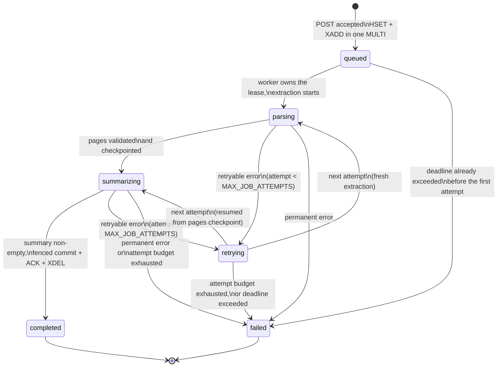

# Architecture

How the async PDF-processing application is put together: processes, the request path, the job
state machine, the Redis and S3 layouts, and the reliability mechanisms that make a killed worker
recoverable without double-committing a result.

Sources for every claim here: `app/`, `compose.yaml`, `infra/`, `frontend/nginx.conf`, and the
verification ledger in [PROGRESS.md](PROGRESS.md). Where something was checked by running it in
this environment, it is marked **verified**. Throughput, latency and fault-injection numbers are
quoted from the measured report [PERFORMANCE.md](PERFORMANCE.md), not re-derived here.

## 1. Infrastructure provisioning and components

### 1.1 What `docker compose up` does

Infrastructure is code: `infra/` is a Terraform tree applied by a one-shot Compose service, so a
reviewer never installs Terraform - `hashicorp/terraform:1.9` runs inside a container. Startup
order is enforced with `depends_on`:

```text
docker compose up --build -d
  |
  +-- redis         (healthy)
  +-- localstack    (healthy; S3 API only, no bucket yet)
  |       |
  |       v
  +-- provisioner   one-shot, working_dir /tf/envs/local, ./infra mounted at /tf
  |       |         terraform init -backend=false
  |       |         terraform apply -auto-approve -input=false
  |       |         terraform output -raw bucket_name
  |       |
  |       `-- api and worker wait for it with
  |           `condition: service_completed_successfully`
  v
  api  +  worker   (start only after the provisioner exits 0)
  |
  v
  frontend
```

- The provisioner is a one-shot service (`restart: "no"`, `TF_IN_AUTOMATION=1`). While it runs,
  `docker compose ps` shows `redis`, `localstack` and `provisioner` only - api, worker and
  frontend are not started yet. This was observed live during this documentation pass.
- **The first run needs network and is slower**: it downloads the AWS provider (a minute or two).
  The provider is cached in `infra/envs/local/.terraform/` afterwards (gitignored).
- **State** lives in `infra/envs/local/terraform.tfstate` (gitignored; it contains resource ids).
  `.terraform.lock.hcl` is committed deliberately, pinning the provider build for every machine.
  Observed in this environment: Terraform `1.9.8`, provider `hashicorp/aws v5.100.0`, and state
  holding exactly three managed resources - `aws_s3_bucket`,
  `aws_s3_bucket_public_access_block`, `aws_s3_bucket_versioning`.
- **Drift healing is the reason Terraform is here**: `apply` refreshes before planning, so after
  `docker compose down -v` (LocalStack state gone, Terraform state intact) it sees that the bucket
  is missing and re-creates it instead of reporting "no changes". Verified by the coordinator:
  refresh detected the vanished bucket, re-created it, and readiness returned `200`.
- **One bucket name feeds both sides.** `compose.yaml` passes
  `TF_VAR_bucket_name: ${S3_BUCKET:-documents}` to the provisioner and `S3_BUCKET` (among the
  passthrough vars) to `api` and `worker`, so Terraform provisions exactly the bucket the app
  reads. Changing `S3_BUCKET` therefore **renames** the bucket: because the name is the resource
  identity, `apply` destroys the old bucket and creates the new one (contents are lost). Verified
  end to end by the coordinator with `S3_BUCKET=pdf-docs-custom`
  (`3 added, 0 changed, 3 destroyed`, `bucket_name = "pdf-docs-custom"`, readiness
  `s3: bucket 'pdf-docs-custom' ok`) and back to the default in reverse. LocalStack itself never
  creates a bucket and receives no `S3_BUCKET`; Terraform owns that resource.
- With only this project's containers running, the documented defaults work unchanged: host port
  `4566`, readiness `200`, and an upload completes (verified by the coordinator after unrelated
  containers were removed; no volumes were touched).

### 1.2 The Terraform tree

| Path | What it defines |
|---|---|
| `infra/versions.tf` | `required_version >= 1.6`; `hashicorp/aws ~> 5.0` |
| `infra/modules/s3/` | Shared bucket module: bucket (3-63 char precondition), public-access block with all four flags, versioning enabled, optional lifecycle (`enable_lifecycle`) expiring non-current versions after 30 days, `force_destroy` flag, tags |
| `infra/modules/ec2-app/` | Production host module: AL2023 AMI lookup, security group (80/443 public; 22 only for listed `ssh_cidr_blocks`, empty by default), all egress, IAM role + inline S3 policy scoped to the bucket ARN + instance profile, EC2 instance (IMDSv2 required, encrypted gp3 root, `ignore_changes = [ami, user_data]`), Elastic IP + association, `user_data` installing Docker + compose plugin into `/opt/app` |
| `infra/envs/local/` | LocalStack provider (endpoint `http://localstack:4566`, `s3_use_path_style = true`, credential/STS/metadata checks skipped, `test`/`test` credentials), `enable_lifecycle = false`, `force_destroy = true`, tags; output `bucket_name`. Applied automatically by Compose |
| `infra/envs/prod/` | Real AWS: provider with default tags, S3 module with lifecycle on and `force_destroy = false`, EC2 host module, `variables.tf`, `terraform.tfvars.example`, outputs (`bucket_name`, `public_ip`, `instance_role_arn`, `next_steps`), commented `backend "s3"` block for remote state |
| `infra/envs/*/.terraform.lock.hcl` | Committed provider lock file (same pin in both envs) |

Why one module and two envs: local and production use the *same* S3 module; only the provider,
backend and module inputs differ. `enable_lifecycle` exists because LocalStack never confirms a
lifecycle configuration (the provider polls for about three minutes and then fails the apply), so
local disables it and production enables it. `force_destroy` is true only locally so
`terraform destroy` can clean up.

### 1.3 What is verified, and what is not

| Check | Status |
|---|---|
| `terraform fmt -check -recursive` | clean (verified in this documentation pass with the `hashicorp/terraform:1.9` image) |
| `terraform validate` for `infra/envs/local` | `Success! The configuration is valid.` (verified in this pass) |
| `terraform validate` for `infra/envs/prod` | `Success! The configuration is valid.` (verified in this pass) |
| Local apply through `docker compose up` | the provisioner added 3 resources, `0 changed, 0 destroyed`; api/worker start only after it exits 0 (verified by the coordinator) |
| Drift healing after `docker compose down -v` with state intact | Terraform refreshed, detected the missing bucket, re-created it (`3 added`), readiness returned `200` (verified by the coordinator) |
| Production environment | **validated only - never applied.** It is not deployed and nothing in AWS was observed |

Production topology: the host does **not** run `compose.yaml` (that would start an in-host
LocalStack and apply the *local* Terraform environment against it, which is pointless once
`infra/envs/prod` created the real bucket). It runs `compose.prod.yaml`: redis + api + worker +
frontend, nginx as the only published port (80), no LocalStack and no provisioner.
`docker compose -f compose.prod.yaml config -q` validates (verified in this pass, exit 0); it has
not been deployed - there is no AWS account here.

### 1.4 Components

| Component | What it is | Responsibility | Explicitly never does |
|---|---|---|---|
| `provisioner` | `hashicorp/terraform:1.9`, one-shot | `terraform init` + `apply` the local environment against LocalStack, then exit; api/worker gate on its exit status | Serve traffic, stay running |
| `api` | FastAPI app under uvicorn (`app.main:app`) | Validate upload, store the source object in S3, write the job hash and stream entry atomically, serve status/parsers/health | Parse a PDF, call a model, block on work |
| `worker` | Same image, different command (`python -m app.worker`) | Consume the stream with bounded concurrency, hold a per-job lease, parse, checkpoint pages, summarize, commit terminal state, drain on SIGTERM | Serve HTTP |
| `redis` | Redis 7.4 with AOF (`--appendonly yes --appendfsync everysec`) | Authoritative job state and the queue (Streams) | Store PDF bytes |
| `localstack` | LocalStack 3.8, `SERVICES=s3` | The S3 API the app and Terraform talk to; it owns no bucket itself - Terraform creates that | Persist anything across recreation (community edition) |
| `frontend` | React + Vite build served by nginx | Static UI, same-origin `/api` and `/health` reverse proxy | Business logic |
| nginx | Inside the `frontend` image | Proxy `/api/` and `/health/` to `api:8000`, SPA fallback, 25 MB body cap | Parse, retry, transform |

The API and worker share one Dockerfile and the same code (`app/config.py`, `app/models.py`,
`app/storage/*`, `app/registry.py`). The API never imports the worker loop. Redis is the only job
state; S3 holds sources only.

Ports are loopback-bound on the host (verified with `docker compose ps`):

```text
frontend   127.0.0.1:3000 -> 80
api        127.0.0.1:8000 -> 8000
localstack 127.0.0.1:${LOCALSTACK_PORT:-4566} -> 4566   (default 4566; override only if the host port is taken)
redis      no published port (Compose network only)
worker     no published port
provisioner no published port (one-shot)
```

## 2. Request path

```text
browser (React :3000)
  |
  | same-origin fetch: /api/v1/...
  v
nginx (frontend container :80) -- /api/ and /health/ --> api:8000
  |
  |  POST /api/v1/documents  (multipart: parser + repeated files)
  v
api (FastAPI :8000)
  |-- validate: parser known + enabled, bounded read, %PDF- signature, limits
  |-- PUT s3://documents/uploads/<uuid>/source.pdf
  |-- MULTI { HSET docs:job:<uuid> ..., XADD docs:jobs * document_id <uuid> }
  `-- 202 {documents:[...], rejected:[...]}
                                     |
                                     |  Redis Stream docs:jobs (field: document_id only)
                                     v
                              worker (same image, python -m app.worker)
                                |-- XREADGROUP group=document-workers count=WORKER_BATCH_SIZE block=2s
                                |-- dispatch up to WORKER_CONCURRENCY jobs; stop reading when full
                                |-- per job: SET NX PX docs:lease:<uuid>  (own execution token)
                                |-- GET s3://documents/uploads/<uuid>/source.pdf
                                |-- parse (PyPDF in a thread, or Gemini per page)
                                |-- SET docs:pages:<uuid> + status=summarizing   (checkpoint)
                                |-- summarize with Gemini (one call, whole document)
                                `-- WATCH/MULTI fenced commit:
                                      status=completed, TTLs on job/pages/summary,
                                      XACK + XDEL the stream entry
```

The API phase is bounded by upload size (max 20 MB per file), not by parsing time. Parsing and
model calls happen only in the worker process, so a slow document cannot slow down `/health/live`,
status reads, or another upload. That property was exercised in the ledger (8 s job in flight:
health 3.7 ms, status 6.1 ms, second POST 10.7 ms).

## 3. Job lifecycle state machine

Statuses are the `DocumentStatus` enum in `app/models.py`: `queued`, `parsing`, `summarizing`,
`retrying`, `completed`, `failed`. Only `completed` and `failed` are terminal
(`DocumentStatus.is_terminal`).



Transition table (what writes the state, and what triggers it):

| From | To | Trigger | Code |
|---|---|---|---|
| (none) | `queued` | Upload accepted; job hash and stream entry committed atomically | `api/documents.py` -> `JobRepository.create_and_enqueue` |
| `queued` | `failed` | The deadline had already passed before the first attempt started | `processing.process` raises `DEADLINE_EXCEEDED` before any stage write |
| `queued`, `retrying` (or a stale non-terminal state) | `parsing` | Worker owns the lease and starts the extraction stage | `processing.JobProcessor._extract` -> `set_stage(PARSING, "parsing")` |
| `parsing` | `summarizing` | Pages extracted, validated (`validate_pages`), and checkpointed | `save_pages` writes status `summarizing` |
| `summarizing` (or resumed) | `summarizing` | Resume path re-enters the summarize stage without extraction | `_summarize` -> `set_stage(SUMMARIZING, "summarizing")` |
| `parsing`/`summarizing` | `retrying` | A retryable error was raised, attempts remain, backoff scheduled | `worker._attempt_loop` -> `JobRepository.mark_retry` |
| `summarizing` | `completed` | Non-empty summary returned; fenced commit, TTLs, XACK, XDEL all succeed | `commit_completed` |
| any non-terminal | `failed` | Permanent error, or a retryable error on the final attempt, or deadline expired | `commit_failed` (via `worker._fail`) |
| any non-terminal | unchanged | Lease was lost mid-work | `LeaseLost` - nothing is written |
| terminal | unchanged | Duplicate delivery (job already terminal) | `worker._handle` acknowledges and drops |

Details that matter when reading a status:

- **`retrying` is a real state, not a stage.** `mark_retry` sets `status=retrying`, clears
  `stage`, increments `attempt`, and stores the last `error` record. The client can poll and see
  it; the next loop iteration writes `parsing` again. Status is therefore not monotonic.
- **`attempt` is incremented before each attempt**, via `HINCRBY`, and starts at `0` in the hash
  until the worker runs. A completed job therefore normally has `attempt` 1. `MAX_JOB_ATTEMPTS`
  is 3 by default, and the failure is `ATTEMPTS_EXHAUSTED` when the counter exceeds it.
- **A retryable error can still end as `failed` with `retryable: true`.** The error record on a
  failed document mirrors the last `ParserError`'s `retryable` flag; if it is `true`, the attempt
  budget or deadline ran out while the underlying error was considered transient.
- **`stage` is `null` or `"parsing"`/`"summarizing"`.** It is set alongside the status and cleared
  on terminal states and on retry. It exists so a stalled job is diagnosable (queued vs working).
- **A resumed job may briefly show a stage from the dead worker** (`parsing`/`summarizing`) before
  the new attempt rewrites it. That is expected, and it is exactly what makes `XPENDING` plus
  `stage` useful when diagnosing a stuck job (see [RUNBOOK.md](RUNBOOK.md)).
- There is a **deadline**: `deadline_at` is written at accept time
  (`time.time() + JOB_DEADLINE_SECONDS`) and checked at the start of each processing attempt. A
  job that starts after the deadline fails immediately with `DEADLINE_EXCEEDED`.

## 4. Redis key schema

Key names are constants in `app/storage/jobs.py`; stream and group names come from settings
(`STREAM_KEY`, `CONSUMER_GROUP`, defaults `docs:jobs` and `document-workers`). The schema is
frozen in [CONTRACT.md](CONTRACT.md) section 6.

| Key | Type | Written by | TTL | Contents |
|---|---|---|---|---|
| `docs:jobs` | Stream | `create_and_enqueue` (XADD); `commit_completed`/`commit_failed` (XACK+XDEL) | n/a | One field only: `document_id`. The stream is a pointer, never a payload. |
| `docs:job:<id>` | Hash | API at accept; repository on every stage/terminal write | `RESULT_TTL_SECONDS` set at terminal state | `id, filename, parser, status, stage, attempt, created_at, updated_at, source_key, page_count, warnings (JSON), error (JSON or empty), deadline_at` |
| `docs:pages:<id>` | String (JSON) | `save_pages` | `EXPIRE` at terminal state (completed and failed) | `{"pages":[{"page_number":1,"format":"text","content":"..."}],"warnings":[...]}` |
| `docs:summary:<id>` | String | `commit_completed` (`SET ... EX ttl`) | `RESULT_TTL_SECONDS` | The document summary markdown. Gemini-only. |
| `docs:lease:<id>` | String + TTL | `acquire_lease` (SET NX PX), `renew_lease` (Lua), `release_lease` (Lua DEL) | `LEASE_SECONDS` while held; removed on clean release | Unique execution token (uuid4 hex) for the worker that owns the job |

Consumer group: `document-workers` on `docs:jobs`, created with `MKSTREAM` at id `0` so entries
already in the stream are consumed. Only `BUSYGROUP` is tolerated as "already created".

Reading the schema in a live stack (verified): an example job hash held exactly
`id, filename, parser, status=completed, stage=<empty>, attempt=1, created_at, updated_at,
source_key=uploads/<uuid>/source.pdf, page_count=2, warnings=[], error=<empty>,
deadline_at=<epoch>`, and `TTL docs:job:<id>` / `TTL docs:summary:<id>` were ~84,000 s with a
24 h result TTL - the terminal TTL was applied. See [RUNBOOK.md](RUNBOOK.md) for the inspection
commands.

Notes:

- Missing/empty fields are the encoding for `None`: `stage=""`, `page_count=""`, `error=""`.
- The job hash is the authoritative record; `docs:pages` and `docs:summary` are the result
  payloads, written through the same lease fence.
- No PDF bytes ever go into Redis, and stream entries never carry the file or its content.

## 5. S3 object layout

| Item | Value |
|---|---|
| Bucket | `S3_BUCKET` (default `documents`), fed to Terraform as `TF_VAR_bucket_name`; owned by Terraform (`infra/modules/s3`) and created by the `provisioner` service before api/worker start in the local environment. Changing the name destroys and re-creates the bucket. |
| Key | `uploads/<document_id>/source.pdf` (constant template `SOURCE_KEY_TEMPLATE` in `app/storage/objects.py`) |
| Key source | **Server-generated UUID only.** The client filename is never used as a key, so path traversal is impossible by construction. |
| Object metadata | `ContentType: application/pdf`, `ContentLength` = uploaded byte count |
| Client config | boto3 with path-style addressing (required by LocalStack), SigV4, `max_attempts=3` standard retries, 5 s connect / 30 s read timeouts; all calls pushed to a thread via `asyncio.to_thread` |
| Versioning | Enabled by the module in both environments. In production a delete keeps previous non-current versions until the lifecycle rule expires them after 30 days (`enable_lifecycle = true`); locally lifecycle is disabled (LocalStack cannot confirm it) and `force_destroy = true` lets destroy clean up. |
| Deletion | Best effort, after a terminal state: after the completed commit, and after a failed commit. A leftover object is harmless; a job pointing at a deleted object is not, hence "only after durable terminal state". |
| Persistence / drift | LocalStack community keeps no state across container recreation. On the next `up` the provisioner applies again; `terraform apply` refreshes first, so a wiped bucket is detected and re-created (drift healing, verified by the coordinator). |

Because S3 and Redis are not transactional, one window is documented rather than hidden: if the
API process dies between `put_source` and the Redis `MULTI`, an unreferenced object can remain
(the API deletes the object only on a definite Redis rejection). There is no orphan-reconciler in
this delivery.

Verified in the live stack: `awslocal s3api head-bucket --bucket documents` returned the bucket
region, and `awslocal s3 ls s3://documents/uploads/` listed nothing after terminal documents,
consistent with source deletion after commit.

## 6. Why the lease, the heartbeat, and the fenced commit exist

Redis Streams with a consumer group give **at-least-once delivery**, not exactly-once. Two
failure modes are inherent, and this design neutralises both:

**Failure mode 1 - reclamation can run two workers at once.** A pending entry whose consumer died
is taken over by `XAUTOCLAIM` after the idle threshold. But "no heartbeat for a while" is not the
same as "dead": a worker can be paused (GC, CPU starvation, container freeze, network partition)
past the threshold while still alive and still working. Without per-job mutual exclusion, both
workers parse and summarize the same document and both try to commit. You also cannot simply
never reclaim, because then a genuinely killed worker strands the job forever.

**Failure mode 2 - the stale worker can win.** Even with a claim, a worker that lost ownership can
wake up later and write. If its write is a plain `HSET`, a completed result can be overwritten by
an older, worse one, or a `failed` can replace a `completed`. If it can `XACK` freely, it can
acknowledge a stream entry that another worker is still responsible for.

The mechanisms, and what each one prevents if removed:

| Mechanism | Implementation | What breaks without it |
|---|---|---|
| Per-job lease | `SET docs:lease:<id> <token> NX PX <LEASE_SECONDS*1000>`; one token per execution; worker logs `job_leased_elsewhere` and leaves the entry pending when it cannot acquire | Any claim can start duplicate work on a live job |
| Heartbeat | Background task calls a Lua compare-and-`PEXPIRE` every `HEARTBEAT_SECONDS`; stops renewing when the token no longer matches | A long parse or model call silently loses the lease mid-flight, then commits nothing (or races another worker) |
| Fenced commit | `WATCH docs:lease:<id>`, compare the token, then `MULTI` the terminal write; new token (or missing key) means the write is rejected and `LeaseLost` is raised | A worker whose lease expired can overwrite a completed result or ack another worker's entry |
| ACK+XDEL inside the terminal transaction | `commit_completed`/`commit_failed` pipeline `XACK` and `XDEL` in the same `MULTI` as the state write | A crash between state write and ACK leaves a completed job pending forever and reprocessed; ACK before state write can lose a job |
| Reclaim threshold = lease length | `effective_reclaim_idle_ms` defaults to `LEASE_SECONDS * 1000`, and `XAUTOCLAIM` runs only when `XREADGROUP` returned nothing | A live worker that renews every heartbeat is never stolen; the two numbers must agree |

The cost of the design is stated, not hidden:

- Delivery remains at-least-once. A crash after a provider call but before the checkpoint repeats
  that provider call, so duplicate provider billing is possible. Duplicate *results* are not: the
  terminal commit is fenced and atomic.
- The lease and commit transactions use `WATCH`/`MULTI` and Lua on a single Redis instance. This
  is **not Redis Cluster compatible**.
- `XAUTOCLAIM` is deliberately a simple sweep (no persisted cursor state machine): one sweep per
  idle read iteration, `START 0-0`, `COUNT 10`. The contract change is documented in
  [DECISIONS.md](DECISIONS.md) item 3.
- The design assumes exactly **one** consumer group, which is why `XDEL` after `XACK` is safe; a
  second group would have had the entry deleted out from under it.

## 7. Why Gemini is called once per page, not once per document

For the `gemini` parser the worker does not send the whole PDF in one request. `_split_pages`
writes one single-page PDF per source page (PyPDF `PdfWriter`), then makes **one model call per
page** with the `PAGE_PROMPT` instruction, sequentially.

The reason is correctness of attribution, not cost efficiency: a whole-document call returns one
blob, and the model decides where page boundaries are. When a document has no visible page breaks,
that silently mis-attributes content, and the API promises ordered per-page content. Splitting
first makes `page_number` deterministic: page N's markdown is the result of page N's call.

The costs and bounds are explicit:

- N calls for an N-page document, run sequentially to respect free-tier rate limits and to keep
  ordering trivially correct. Sequential **within** a document; several documents can be in flight
  at once, bounded by `WORKER_CONCURRENCY` and paced per process (section 10.3).
- The AI parser is capped by `MAX_AI_PAGES` (default 20) and fails with
  `TOO_MANY_PAGES_FOR_AI` above it; the page-level text cap is `MAX_EXTRACTED_CHARS`.
- A page that yields the literal marker `(no extractable text)` is stored as an empty page with a
  warning, keeping page numbers contiguous. If every page is empty, the parser fails with
  `OCR_REQUIRED`.
- The **summary is separate and always document-level**: after all pages are extracted and
  checkpointed, `GeminiSummarizer` is called once with the pages delimited as
  `[PAGE n] ... [END PAGE n]`, and returns one summary string per document. A failed summary
  keeps the extracted pages (a `failed` document can still return readable pages).

## 8. Upload to completed, step by step

```text
1. Client POSTs multipart (parser field + repeated files fields) to /api/v1/documents.
2. API parses the parser name against ParserId: unknown -> 422; disabled -> 503 (before reading files).
3. API checks file count <= MAX_BATCH_FILES: else 413.
4. For each file, in order:
   a. sanitize the filename (basename, printable only, max 200 chars);
   b. bounded chunked read (1 MB chunks, stop once MAX_UPLOAD_BYTES is exceeded) -> 413 if exceeded;
   c. running batch total > MAX_BATCH_BYTES -> 413;
   d. empty -> rejected[] EMPTY_FILE; missing %PDF- signature -> rejected[] NOT_A_PDF;
   e. PUT uploads/<new-uuid>/source.pdf in a thread; object-store failure -> rejected[] STORAGE_UNAVAILABLE;
   f. build DocumentJob (status queued, deadline_at = now + 600 s);
   g. MULTI { HSET docs:job:<id>; XADD docs:jobs * document_id <id> }; on RedisError delete the
      just-uploaded object and reject with QUEUE_UNAVAILABLE.
5. Respond 202 {documents, rejected} if at least one file was accepted; else 422 (or 503 when the
   only failures were storage/queue failures).
6. Worker loop: XREADGROUP (count WORKER_BATCH_SIZE=8, block 2 s); if empty, XAUTOCLAIM stale
   entries (same count). One asyncio task is dispatched per message, bounded by a semaphore of
   WORKER_CONCURRENCY=4; while every slot is busy the loop stops reading (backpressure).
7. Worker loads the job hash. Missing hash -> ack the orphan entry and drop. Already terminal -> ack and drop.
8. Worker acquires that job's own lease (SET NX PX). Held elsewhere -> log and leave the entry pending.
9. Start that job's heartbeat task (renew every 15 s, fenced by token). Concurrent jobs share no
   mutable state; each has its own lease, token, heartbeat, retry budget and pacer position.
10. Attempt loop: HINCRBY attempt; if > MAX_JOB_ATTEMPTS -> fail ATTEMPTS_EXHAUSTED.
11. Processor checks deadline_at; expired -> fail DEADLINE_EXCEEDED.
12. If docs:pages:<id> exists, resume: skip extraction (log job_resumed).
13. Otherwise: status parsing; GET the source from S3; parse (PyPDF thread, or Gemini per-page calls);
    validate pages (1-based, contiguous); save_pages writes docs:pages:<id> JSON, sets
    status=summarizing, page_count and warnings - still fenced by the lease token.
14. Status summarizing; get the summarizer; one Gemini call over the delimited pages.
15. Empty summary -> fail SUMMARY_EMPTY. Otherwise the fenced MULTI: status=completed, clear
    stage/error, TTL on job/pages/summary, SET summary with TTL, XACK and XDEL.
16. On success: delete the source object (best effort) and release the lease.
17. On failure: commit_failed (fenced, same XACK/XDEL pattern), delete the source object, release
    the lease.
18. A retryable failure with attempts left instead marks retrying, sleeps the backoff from
    RETRY_BACKOFF_SECONDS, and loops from step 10 with the same lease and token.
```

Client-visible consequence: `GET /api/v1/documents/{id}` returns `200` for every known state.
`pages` is `[]` and `summary` is `null` until they are produced; `error` is `null` until a
terminal failure. Full field and status-code detail is in [API.md](API.md).

## 9. Crash recovery

The recovery story follows directly from the mechanisms above.

| Crash point | State left behind | What happens next |
|---|---|---|
| API dies between S3 PUT and the Redis MULTI | Orphan S3 object, no job | Documented orphan window; no reconciler. Nothing is returned to a client because the request died. |
| Worker dies before extraction finishes | Stream entry pending; `docs:job` shows `parsing`; no `docs:pages` | After `LEASE_SECONDS` of idle, another worker's `XAUTOCLAIM` claims the entry, acquires the lease (the old lease has expired or is deleted by TTL), and re-runs extraction from scratch. Duplicate provider calls are possible here. With `WORKER_CONCURRENCY > 1`, a SIGKILL takes all of that process's in-flight jobs and each is reclaimed independently. |
| Worker dies after `save_pages`, before the summary | Stream entry pending; `docs:pages` exists; status `summarizing` | Reclaimed worker sees the checkpoint, logs `job_resumed`, and skips extraction. Only the summary is repeated. |
| Worker dies after the terminal `MULTI` | Stream entry already ACKed+XDELed; terminal state durable | Nothing to recover. The job is terminal; a duplicate delivery would be acked and dropped at step 7. |
| Worker loses its lease but keeps running | Lease token changed or expired; entry may have been claimed | Every subsequent fenced write returns `False`; `LeaseLost` propagates; the worker logs `lease_lost (no state written)` and exits that job without writing or acking. |
| Worker is SIGTERM'd (deploy, restart) | Reading stops immediately; in-flight jobs still hold their leases | The worker logs `worker_draining`, gives jobs up to `WORKER_SHUTDOWN_GRACE_SECONDS` (30 s), then cancels the rest (`worker_shutdown_incomplete`). Nothing is acknowledged because shutdown began; unfinished entries stay pending and a replacement reclaims them from the checkpoint. |
| A job hits a Redis error mid-processing (for example during `commit_completed`) | The entry is not acknowledged and the document is not terminal | The attempt loop re-raises `RedisError` (`job_deferred_redis_unavailable`) instead of classifying it as a document failure. The message stays pending and a reclaim resumes from the checkpoint. This is the fix for the bug where a transient store blip became a permanent `INTERNAL_ERROR` failure. |
| One concurrent job task raises unexpectedly | The other jobs are unaffected | The task callback logs `job_task_crashed`, releases the slot, and the worker keeps consuming. |
| Job hash expired while the entry is still pending | Orphan stream entry | The worker acks and deletes it (`orphan_stream_entry`), so it cannot feed a claim loop forever. |

Recovery is not instantaneous: the observe-to-recovery latency is bounded by the worker's read
block (2 s) plus the reclaim idle threshold (`LEASE_SECONDS`, 90 s by default) plus the next
`XAUTOCLAIM` sweep. See the stuck-job and manual-reclaim procedures in [RUNBOOK.md](RUNBOOK.md).

## 10. Worker concurrency, backpressure, and provider pacing

### 10.1 Dispatch

- One worker process runs `WORKER_CONCURRENCY` jobs at once (default 4). The cap is an
  `asyncio.Semaphore`: each received stream entry becomes one task that holds a slot for its whole
  lifetime.
- Reading and processing are coupled on purpose. `XREADGROUP` asks for `WORKER_BATCH_SIZE` entries
  (default 8; keep it >= concurrency so slots are never idle); the loop then waits for a free slot
  before dispatching each entry. When every slot is busy it stops issuing reads, and at most the
  current batch is held undelivered, so it can never buffer unbounded work in memory. That is the
  backpressure mechanism. Saturation appears as `worker_saturated` in the log at DEBUG level (so
  `LOG_LEVEL=DEBUG` to see it) and externally as growing stream lag / pending entries.
- Jobs share nothing mutable: each has its own lease token, heartbeat task, attempt counter and
  (for the AI parsers) its own position in the provider pacer. The lease/fencing guarantees are
  per job, so concurrency does not weaken them - two jobs cannot collide, and two workers cannot
  double-commit one job.
- One job cannot crash the worker: the task callback logs `job_task_crashed` and releases the slot,
  and `_handle` failures are caught per task.
- This is I/O concurrency inside one process, not multiprocessing. PyPDF work still runs in threads
  (`asyncio.to_thread`), so CPU-bound parsing stops scaling around the number of cores; the
  measured curve is 4.22 -> 16.32 -> 22.99 settled docs/s at concurrency 1 -> 4 -> 8
  ([PERFORMANCE.md](PERFORMANCE.md)).
- Backlog is accepted, not shed: the API has no admission control, so uploads keep returning `202`
  while the queue grows and the worker stays saturated. Memory during the upload phase is bounded
  by in-flight uploads x `MAX_BATCH_BYTES`, not by the queue.

### 10.2 Shutdown and draining

- SIGTERM/SIGINT only sets a stop flag: the loop stops reading the stream immediately, then
  `_drain` waits up to `WORKER_SHUTDOWN_GRACE_SECONDS` (default 30) for in-flight jobs.
- Jobs that finish within the grace period commit and ACK normally. Jobs still running are
  cancelled and logged as `worker_shutdown_incomplete`; their entries stay pending and are
  reclaimed by a replacement worker after the lease expires, resuming from the pages checkpoint.
- Nothing is ACKed merely because shutdown started. A `SIGKILL` has no drain at all and takes all
  in-flight jobs with it; each is reclaimed the same way.

### 10.3 Provider pacing

Three layers, all client-side, in `app/providers/gemini.py` plus the worker's retry policy:

1. `PROVIDER_MAX_CONCURRENCY` (default 4) - a semaphore around each provider request, per process.
2. `PROVIDER_MAX_REQUESTS_PER_MINUTE` (default 0 = disabled) - a continuously refilled token
   bucket; calls wait before reaching the provider instead of discovering the limit as a 429.
3. `Retry-After` (clamped by `RETRY_AFTER_MAX_SECONDS`, default 30 s) and jittered backoff - when a
   429/503 does arrive, the worker honours the provider's delay within that cap and adds jitter so
   parallel jobs do not retry in lockstep.

The pacing state is per process: N worker processes multiply the effective request rate, which is
why `PROVIDER_MAX_REQUESTS_PER_MINUTE` must come from the provider's published limit (divide it
across processes if you ever run more than one). Measured effect: a 20-document live burst with no
pacing failed documents with `PROVIDER_ERROR` after 429/503 responses exhausted the retry budget;
paced at 20 RPM it completed 20/20 (0.76 docs/s, almost exactly 20 RPM / 3 calls per document).
Tuning rule: `throughput ~= RPM / calls_per_document`. Details and caveats:
[PERFORMANCE.md](PERFORMANCE.md).

## 11. API responsiveness, retries, and bounds

- The API event loop never runs blocking I/O directly: boto3 calls are wrapped in
  `asyncio.to_thread`, PyPDF extraction runs in a thread, Gemini calls are awaited (async SDK).
- `/health/ready` runs each dependency check under a 5 s `asyncio.wait_for`.
- Measured API responsiveness: 200 concurrent uploads were accepted with 0 HTTP errors (p95 upload
  1555 ms) while the worker was the bottleneck, and 100-document runs at client concurrency
  1/10/50/100 had 0 errors and p95 upload latency 9/88/651/802 ms. See
  [PERFORMANCE.md](PERFORMANCE.md).
- Bounds (defaults in `app/config.py`): 20 MB per file, 5 files / 50 MB per batch, 50 pages
  (PyPDF), 20 pages (AI parser), 200,000 extracted characters, 60 s provider timeout, 3 attempts,
  600 s job deadline, 90 s lease / 15 s heartbeat, 24 h result TTL. The full table with the exact
  enforcement point is in [API.md](API.md#limits); the concurrency and pacing knobs are tabled in
  [DEVELOPING.md](DEVELOPING.md#tuning-knobs).
- Retry policy lives in the worker: a `TransientError` gets `RETRY_BACKOFF_SECONDS` (2 s, 5 s,
  10 s, clamped to the last value) until `MAX_JOB_ATTEMPTS`, preferring the provider's
  `Retry-After` when the error carries one (clamped by `RETRY_AFTER_MAX_SECONDS`) and otherwise
  adding +/-20% jitter. A `PermanentError` fails immediately. A `RedisError` is neither: it is a
  dependency blip, so it is re-raised and the job is deferred, never failed. Provider SDKs are
  configured to make **one** attempt (`HttpRetryOptions(attempts=1)`) so the worker's budget and
  the 60 s timeout stay authoritative.
- The Gemini adapter maps provider failures into that vocabulary: 429/5xx/timeouts ->
  `TransientError` (carrying `retry_after` when the provider sent one); other HTTP 4xx and
  configuration/safety problems -> `PermanentError`. Every unknown failure is transient, so it is
  retried a bounded number of times and then fails with a stable code.
- Single Redis instance is an explicit assumption; see section 6.
